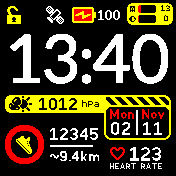
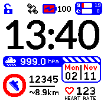

# Pawl Clock

Quadrante digitale a tutto schermo per **Bangle.js 2**.

 

## Funzionalità

- Ora aggiornata al minuto, giorno della settimana e data.
- Passi giornalieri, anello dell’obiettivo e distanza stimata in base all’altezza.
- Battito cardiaco dai dati health e dalle letture HRM disponibili.
- Pressione atmosferica con icone indicative: non sono previsioni meteo e risentono dell’altitudine.
- Batteria e ricarica, utilizzo RAM e memoria, stato Bluetooth, GPS e blocco.
- Temi chiaro e scuro. I widget vengono nascosti e ripristinati all’uscita.

La distanza contrassegnata da `~` è una stima; `--` indica una lettura non disponibile.

## Uso

Installa l’app tramite un App Loader che includa Pawl Clock e selezionala come
quadrante nelle impostazioni dell’orologio. Il pulsante fisico apre il launcher.

Per attivare il **Live temporaneo**, tieni premuto lo schermo sbloccato per
**1,5 secondi**: passi, batteria, memoria e pressione si aggiornano più spesso,
il sensore cardiaco viene richiesto e i due punti dell’ora lampeggiano ogni secondo.
Durante la pressione lo schermo resta acceso, illuminato e sbloccato: i timeout
automatici sono sospesi. Al rilascio tornano gli intervalli e i timeout precedenti,
con il conteggio di inattività che riparte da quel momento. Un blocco o spegnimento
esplicito dell’LCD interrompe comunque il Live temporaneo. I due punti tornano fissi
e la richiesta al sensore cardiaco viene rilasciata; le richieste di altre app restano attive.

Il GPS non viene acceso dal quadrante. Il sensore cardiaco è richiesto solo
durante il Live temporaneo: i BPM cambiano all’arrivo di letture affidabili,
quindi la prima misura può richiedere alcuni secondi.

## Impostazioni

Apri **Settings → App/Widget Settings → Pawl Clock**.

| Voce | Funzione e valore predefinito |
| --- | --- |
| **Theme** | Light o Dark; predefinito Dark. |
| **Update LCD off?** | Continua gli aggiornamenti con LCD spento; inizialmente attivo. |
| **Intervalli di aggiornamento** | Separati per pressione, memoria, batteria e passi: Live, 15/30 secondi, 1/3/5/10 minuti. Predefinito: 1 minuto. |
| **User Height** | Altezza per stimare la distanza: 100–220 cm, predefinito 175 cm. |
| **Step Goal** | Obiettivo: 1.000–10.000 passi, predefinito 5.000. |
| **Weather Min/Max Pressure** | Soglie delle icone: 1005/1020 hPa; il minimo deve restare inferiore al massimo. |
| **Debug** | Evidenzia le aree ridisegnate; normalmente disattivato. |

In Live, batteria e memoria si aggiornano ogni secondo, i passi a ogni evento e
il barometro campiona continuamente. Le preferenze delle vecchie versioni vengono
migrate automaticamente.

## Risparmio energetico

Per ridurre il lavoro del quadrante, una configurazione di partenza è:

- **Pressione:** ogni 5 minuti, per distanziare i campionamenti del barometro.
- **Memoria:** ogni 10 minuti; **batteria:** ogni 5 minuti.
- **Passi:** ogni minuto, evitando un ridisegno a ogni passo.
- **Debug:** disattivato. Usa il Live temporaneo solo quando serve, perché attiva il sensore cardiaco e mantiene accesa la retroilluminazione.
- Disattiva **Update LCD off?** se vuoi sospendere gli aggiornamenti quando l’LCD è spento.

Su Bangle.js 2 l’LCD normalmente resta acceso anche con la retroilluminazione
spenta: questa opzione non sospende gli aggiornamenti al semplice spegnimento
della luce o al blocco dello schermo.

Con intervalli normali il quadrante rilascia il barometro dopo ogni campionamento;
in Live lo mantiene richiesto. All’uscita rilascia la propria richiesta senza
interrompere quelle di altre app.

Per installazione manuale, migrazione e test, consulta [la guida tecnica](DEVELOPMENT.md).
